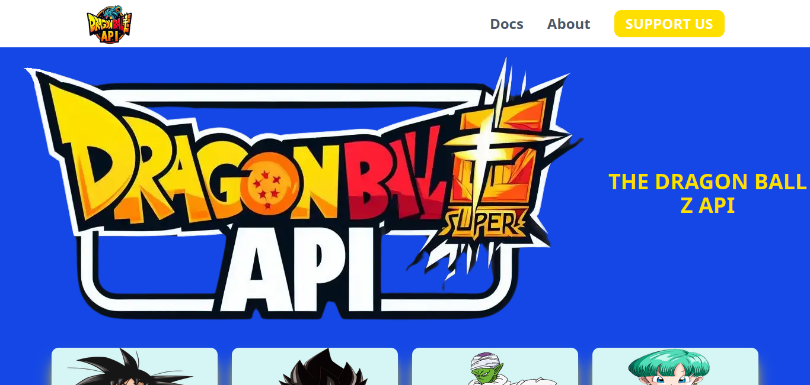

# 🐉 Dragon Ball Z API Explorer


Une application web moderne qui explore l'univers **Dragon Ball Z** en consommant l'API publique [dragonball-api.com](https://dragonball-api.com). Affichage dynamique des personnages avec leurs statistiques (Ki, race, genre, affiliation) dans une interface élégante aux couleurs de l'univers DBZ.

---

## ✨ Aperçu



---

## 🚀 Fonctionnalités

- 🔄 **Récupération dynamique** des personnages via Axios
- 🎨 **Design thématique DBZ** : bleu profond, or (#FFDF00) et touches de blanc glacé
- 🖱️ **Animations au survol** : zoom progressif des images de personnages
- 📱 **Responsive** : grille flexible avec Flexbox et Tailwind
- ⚡ **Chargement optimisé** avec `useEffect` et `useState`
- 🌙 **Thème sombre** avec cartes en gris anthracite (#2D2D2D)

---

## 🛠️ Technologies utilisées

| Technologie         | Rôle                              |
| ------------------- | --------------------------------- |
| **React**           | Bibliothèque UI                   |
| **Vite**            | Bundler ultra-rapide              |
| **Tailwind CSS**    | Framework CSS utilitaire          |
| **Axios**           | Requêtes HTTP vers l'API          |
| **Dragon Ball API** | Source de données des personnages |

---

## 📦 Installation

### Prérequis

- Node.js ≥ 18
- npm ou yarn

### Étapes

```bash
# 1. Cloner le dépôt
git clone https://github.com/Dimi-programmeur/Dragon-Ball-Z-API-Explorer.git
cd Dragon-Ball-Z-API-Explorer

# 2. Installer les dépendances
npm install

# 3. Lancer le serveur de développement
npm run dev
```

L'application sera disponible sur `http://localhost:5173`

### Build de production

```bash
npm run build
npm run preview
```

---

## 🌐 API utilisée

**Endpoint principal :**

```
GET https://dragonball-api.com/api/characters
```

**Exemple de réponse :**

```json
{
  "items": [
    {
      "id": 1,
      "name": "Goku",
      "race": "Saiyan",
      "gender": "Male",
      "ki": "60.000.000",
      "maxKi": "90 Septillion",
      "affiliation": "Z Fighter",
      "image": "https://..."
    }
  ]
}
```

📚 Documentation complète : [dragonball-api.com/documentation](https://dragonball-api.com/documentation)

---

## 📂 Structure du projet

```
Dragon-Ball-Z-API-Explorer/
├── public/
├── screenshots/
│   └── apercu.png
├── src/
│   ├── assets/
│   ├── App.jsx          # Composant principal
│   ├── main.jsx         # Point d'entrée React
│   └── index.css        # Styles Tailwind
├── index.html
├── tailwind.config.js
├── package.json
└── README.md
```

---

## 🎨 Palette de couleurs

| Couleur        | Hex       | Utilisation               |
| -------------- | --------- | ------------------------- |
| 🟡 Or          | `#FFDF00` | Accents, valeurs, boutons |
| 🔵 Bleu DBZ    | `#1D4ED8` | Fonds de sections         |
| ⚫ Anthracite  | `#2D2D2D` | Cartes de personnages     |
| ⚪ Blanc glacé | `#D6F5F5` | Conteneur des images      |

---

## 🔮 Améliorations futures

- [ ] 🔍 Barre de recherche par nom
- [ ] 🎯 Filtres par race / affiliation
- [ ] 📄 Pagination ou scroll infini
- [ ] 🌍 Page de détail par personnage
- [ ] ⏳ Skeleton loader pendant le chargement
- [ ] ❌ Gestion des erreurs API
- [ ] 🌙/☀️ Toggle dark/light mode

---

## 🤝 Contribution

Les contributions sont les bienvenues !

```bash
# 1. Fork le projet
# 2. Créer une branche
git checkout -b feature/ma-fonctionnalite

# 3. Commit
git commit -m "feat: ajout de ma fonctionnalité"

# 4. Push
git push origin feature/ma-fonctionnalite

# 5. Ouvrir une Pull Request
```

---

## 📄 Licence

Ce projet est sous licence **MIT**. Voir le fichier [LICENSE](./LICENSE) pour plus de détails.

---

## 🙏 Remerciements

- [Dragon Ball API](https://dragonball-api.com) pour les données
- [Akira Toriyama](https://fr.wikipedia.org/wiki/Akira_Toriyama) pour cet univers légendaire 🐉
- La communauté React & Tailwind

---

<div align="center">

**⭐ Si ce projet t'a plu, n'hésite pas à lui donner une étoile ! ⭐**

Fait avec ❤️ et beaucoup de Ki

</div>
